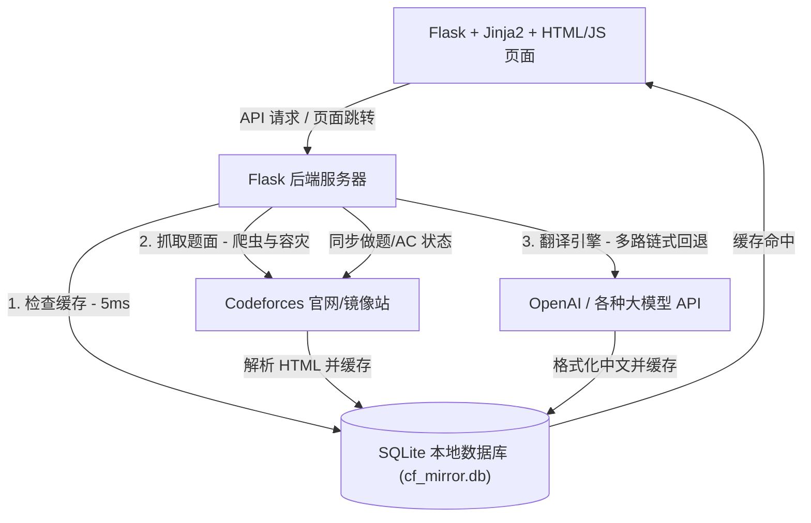

# Codeforces AI 智能双语翻译镜像站 (Premium Mirror)

> [!CAUTION]
> **🔒 本地自用安全警告与凭据保护提示 (Security & Credentials Warning)**
> 本系统为**本地自用设计**，您在“管理后台”录入的 Codeforces Handle、登录 Cookie 以及大模型 API Key 均以明文安全保存在本地 SQLite 数据库 `cf_mirror.db` 中。
> - **切勿将包含您真实私密数据的 `cf_mirror.db` 文件分享或提交至 GitHub 等任何公开仓库！**
> - **切勿与他人分享您的 `cf_mirror.db` 数据库文件！**
> - 本项目的 `.gitignore` 已预置安全防御规则自动拦截 `.db` 和 `.log` 文件，请务必保持防御配置开启，时刻保障个人账号资产安全。

---

这是一个为算法竞赛选手量身定制的 Codeforces 双语对照阅读与状态同步系统。本系统已经过全面架构重构，从原有的 FastAPI + React/TS 双端口前后端分离方案，整合迁移到了纯 Python 的 **Flask + Jinja2 + HTML/Vanilla JS 统一架构**，单端口、单进程运行，完全移除了 Node.js 与 npm 编译依赖。

---

## 🏗️ 核心系统架构 (System Architecture)

系统由以下核心模块协同运作，构建成工业级闭环：



1. **LaTeX 语法保护与爬虫模块 (`scraper.py`)**：
   - 抓取 Codeforces 原站 HTML。提取标题、限制、题面描述、输入/输出说明、评测样例以及提示（Notes）。
   - 内置 tokenizer 安全机制，对 Codeforces 原生 `$$$` 极其易碎的 LaTeX 标记进行捕获并清洗为标准 `$` 符号界定符，为 LLM 翻译做足语法保护。

2. **MathJax 3 渲染系统与原生 JS 交互**：
   - **离线渲染加载**：本地集成并版本控制了 MathJax 3 (包含 `color` 扩展)，不需要加载任何外部 CDN，完全本地离线渲染 SVG 格式公式，保障极速、稳定的公式展示体验。
   - **原生 JS 调度 (`static/js/app.js`)**：使用纯原生 JavaScript (Vanilla JS) 异步请求 API，处理 Toast 消息队列、批量翻译队列 60s 冷却安全防风控计时、做题状态定时同步以及代码直接提交和评测 verdict 进度监控的轮询。

3. **大模型多路容灾翻译链 (`translator.py`)**：
   - 允许用户在管理后台配置多组 LLM 模型节点（如 DeepSeek, GPT, Claude 等）。
   - **链式降级回退（Fallback Chain）**：如果优先级最高的 API 发生限流或欠费报错，系统会自动无缝切换至备用 API，若全部失败，平滑切换至系统自愈的“模拟翻译模式”，确保流程不发生阻断性 Crash。

4. **双向本地持久化缓存层 (`database.py` & `main.py`)**：
   - **题目缓存**：已翻译题目 100% 缓存入本地 SQLite，方便您在“本地已译题目”列表里进行零网络开销的历史查阅。
   - **大厅缓存（6h TTL）**：比赛大厅引入了 6 小时生命期缓存。第二次加载大厅实现 **5ms 瞬间秒开**，彻底告别原版 CF 接口的漫长转圈圈。
   - **离线安全高可用**：即使在断网状态，大厅依然允许加载过期缓存作为 Fallback，保障 100% 软件可用性。

5. **全链路高性能日志黑匣子 (`backend_app.log`)**：
   - 拦截所有发起的 HTTP 流量。
   - 自动在控制台与本地滚动日志中打印访问 IP、方法、路径、**毫秒级网络响应时长**以及 500 堆栈，方便硬核排错。

---

## 📁 规范项目工程目录 (Project Tree)

```text
CF/
├── templates/                # Jinja2 HTML 模板
│   ├── base.html             # 基础骨架模板 (侧边栏、Toast通知、全局做题同步状态栏)
│   ├── dashboard.html        # 官方比赛大厅
│   ├── problemset.html       # 官方题库检索列表
│   ├── problem.html          # 双语对照阅读与代码在线提交编辑器
│   ├── cached.html           # 本地缓存题面历史
│   └── settings.html         # 管理后台 (配置 LLM 节点与 CF Handle/Cookie)
│
├── static/                   # 静态资源
│   ├── css/
│   │   └── index.css         # 统一 CSS 样式 (保留原 React 原版色彩与动效)
│   ├── js/
│   │   └── app.js            # 原生 JavaScript 核心交互逻辑
│   └── mathjax/              # 离线 MathJax 3 静态渲染 JS 库与图标
│
├── .gitignore                # Git 忽略清单 (防止敏感数据泄露)
├── database.py               # 数据库 ORM (SQLite 表结构与自动迁移)
├── scraper.py                # Codeforces HTML 题面解析及 LaTeX 捕获保护
├── translator.py             # LLM 容灾链智能翻译引擎
├── paths.py                  # 本地持久化路径解析工具
├── cf_sync.py                # Codeforces API 数据同步与做题状态后台同步
├── pages.py                  # Jinja2 渲染的页面路由 Blueprint
├── api.py                    # REST API JSON 接口路由 Blueprint
├── requirements.txt          # Python 依赖清单
├── main.py                   # Flask 应用服务入口与主配置
└── README.md                 # 软件工程系统架构与运维手册
```

---

## 🚀 部署与启动说明 (Deployment & Startup)

因为完全摒弃了 Node.js 体系，部署和启动极其简单，仅需标准的 Python 环境。

### 1. 安装依赖包
请确保您的系统已安装 Python 3.8+。
```bash
pip install -r requirements.txt
```

### 2. 启动服务
- **本地调试启动**（支持代码热重载）：
  ```bash
  python main.py
  ```
  服务将在默认的 `http://127.0.0.1:8000` 端口运行。

- **服务器生产部署**：
  推荐使用 `gunicorn` 或其他 WSGI 容器，以提升并发处理能力和稳定性：
  ```bash
  gunicorn main:app -b 127.0.0.1:8000 -w 4
  ```

---

## 🔒 Codeforces 做题状态同步与高级设置

为了在本地镜像站自动同步并显示您在 Codeforces 的做题记录 (AC/FAILED 状态标记)：
1. 您只需要前往镜像站的 **「管理后台 (设置)」** 中录入您的 **Codeforces 用户名 (Handle)**，即可立刻开启极速异步状态同步。AC 状态同步完全由公共接口拉取，**不需要提供任何密码或 Cookie 凭据**，保障您的账号资产安全！
2. 浏览器登录 Cookies 仅作为高级/保留功能折叠在后台设置中（用于直接在线提交代码进行评测）。如无特殊需要，建议保持留空即可。如果需要在线提交功能，请确保正确获取并在设置中输入您在 `codeforces.com` 的 Session Cookie。
