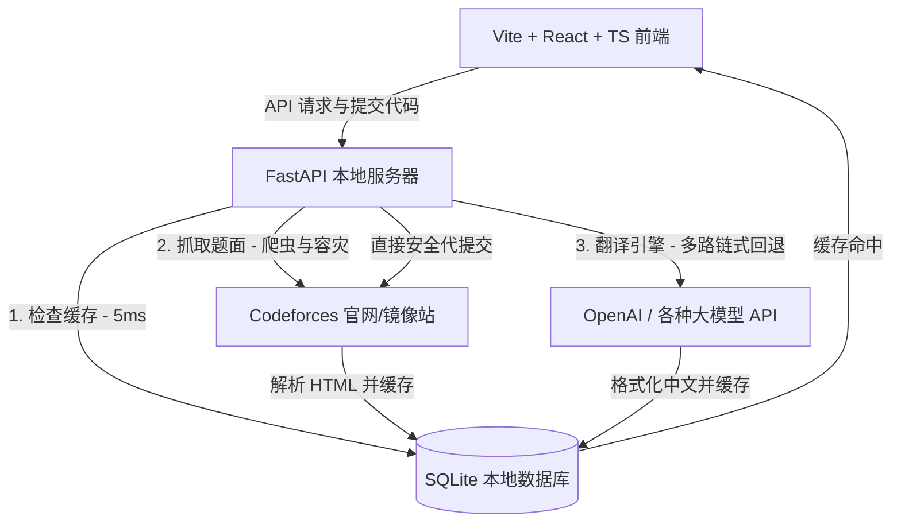

# Codeforces AI 智能双语翻译镜像站 (Premium Mirror)

这是一个为算法竞赛选手量身定制的 Codeforces 双语对照阅读与安全直交镜像系统。通过结合轻量级网页爬虫、大模型多路容灾翻译引擎、React 协调隔离渲染技术以及本地缓存防抖机制，本系统能让您在本地电脑上享受极致流畅、小说般舒适的中文刷题与评测体验。

---

## 🏗️ 核心系统架构 (System Architecture)

系统由以下五大核心模块协同运作，构建成工业级闭环：



1. **LaTeX 语法保护与爬虫模块 (`scraper.py`)**：
   - 抓取 Codeforces 原站 HTML。提取标题、限制、题面描述、输入/输出说明、评测样例以及提示（Notes）。
   - 内置 tokenizer 安全机制，对 Codeforces 原生 `$$$` 极其易碎的 LaTeX 标记进行捕获并清洗为标准 `$` delims，为 LLM 翻译做足语法保护。

2. **React Memo 隔离与 MathJax 3 渲染系统 (`ProblemViewer.tsx`)**：
   - **协调隔离（Memoization）**：为了彻底解决 React 虚拟 DOM 协调时将外部数学公式打回原形的问题，本系统将所有渲染的数学公式隔离在受 `React.memo` 保护的 `ProblemContent` 子组件中。即使您在主页面打字写代码、切换编译器或轮询评测，渲染后的公式也绝不会发生闪烁与退化。
   - **双 CDN 容灾**：前端内置 BootCDN 极速加载，并配有 cdnjs (Cloudflare) 自动无缝 Failover 容灾加载机制。

3. **大模型多路容灾翻译链 (`translator.py`)**：
   - 允许用户在管理后台配置多组 LLM 模型节点（如 DeepSeek, GPT, Claude 等）。
   - **链式降级回退（Fallback Chain）**：如果优先级最高的 API 发生限流或欠费报错，系统会自动无缝切换至备用 API，若全部失败，平滑切换至系统自愈的“模拟翻译模式”，确保流程不发生阻断性 Crash。

4. **双向本地持久化缓存层 (`database.py` & `main.py`)**：
   - **题目缓存**：已翻译题目 100% 缓存入本地 SQLite，方便您在“本地已译题目”列表里进行零网络开销的历史查阅。
   - **大厅缓存（6h TTL）**：比赛大厅引入了 6 小时生命期缓存。第二次加载大厅实现 **5ms 瞬间秒开**，彻底告别原版 CF 接口的漫长转圈圈。
   - **离线安全高可用**：即使在断网状态，大厅依然允许加载过期缓存作为 Fallback，保障 100% 软件可用性。

5. **全链路高性能日志黑匣子 (`backend_app.log`)**：
   - 拦截所有前端发起的 HTTP 流量。
   - 自动在控制台与本地滚动日志中打印访问 IP、方法、路径、**毫秒级网络响应时长**以及 500 堆栈，方便硬核排错。

---

## 📁 规范项目工程目录 (Project Tree)

```text
CF/
├── backend/                  # 后端 FastAPI 翻译服务器
│   ├── __pycache__/
│   ├── cf_mirror.db          # SQLite 本地自愈式数据库 (自动生成并迁移)
│   ├── backend_app.log       # 本地 10MB 自动轮转性能日志 (自动生成)
│   ├── database.py           # SQLAlchemy 数据结构与索引自修复配置
│   ├── main.py               # FastAPI 服务主入口与日志/缓存中间件
│   ├── requirements.txt      # 后端依赖配置清单
│   ├── scraper.py            # Codeforces 题面抓取与 LaTeX 保护核心
│   └── translator.py         # LLM 链式智能翻译与 Fallback 降级引擎
│
├── frontend/                 # 前端 React + TypeScript 现代应用
│   ├── dist/                 # 静态打包资源目录
│   ├── node_modules/         # 前端依赖包
│   ├── public/               # 公共静态静态资源
│   ├── src/
│   │   ├── assets/
│   │   ├── AdminSettings.tsx # 大模型 Key 与 Cookie 配置后台
│   │   ├── App.css
│   │   ├── App.tsx           # 主程序控制中心与侧边栏路由
│   │   ├── CachedProblems.tsx# 本地已翻译历史题库视图
│   │   ├── Dashboard.tsx     # 极简官方比赛大厅与快速通道 (内置 Modal)
│   │   ├── index.css         # Harmonious Premium CSS 设计系统
│   │   ├── main.tsx
│   │   ├── ProblemsetLibrary.tsx # 官方 30000+ 题库快速检索面板
│   │   └── ProblemViewer.tsx # 双语对照阅读器与直接安全提交组件 (Memo)
│   ├── eslint.config.js
│   ├── index.html            # MathJax 3 配置与双路 CDN 加载 failover
│   ├── package.json          # 前端依赖与脚手架指令
│   ├── tsconfig.json         # TypeScript 编译配置
│   └── vite.config.ts        # Vite 打包配置
│
├── .gitignore                # 仓库级别防污染 Git 忽略清单
├── README.md                 # 软件工程系统架构与运维手册
├── start.py                  # 一键重定向 Conda 极速启动与热重载监测管理脚本
└── scratch_test.py           # 临时系统检测沙盒脚本
```

---

## 🚀 极速上手说明 (Quick Start)

### 1. Windows 一键启动 (最推荐)
如果您是 Windows 用户，无需任何前置安装，直接在项目根目录下双击运行：
* **`一键启动.bat`**

**该启动引导器会自动：**
1. 检测系统是否安装了 Python 3.8+。若未检测到，将通过 Windows `winget` 自动为您安全静默安装 Python 3.11。
2. 检测并自动修复 `pip` 包管理器。如果缺失，会自动从官方下载并配置好。
3. 检测系统是否安装了 Node.js / npm 环境。若缺失，将自动为您下载并安装最新 Node.js LTS 版本。
4. 调用底层的 `start.py` 核心引导程序：
   - 自动检测并创建 **Python 官方自带的虚拟环境 (`.venv`)**。
   - 自动在虚拟环境中补全安装后端所有 Python 依赖包。
   - 自动使用国内淘宝极速镜像源补全安装前端所有 npm 依赖包。
   - 自动检测并占用释放本地 `8000` 与 `5173` 端口。
   - 自动拉起后端服务器与前端应用，并在默认浏览器中为您**秒开加载**主界面！

---

### 2. 跨平台手动启动 / 自定义启动 (Linux / macOS / Windows CMD)
如果您习惯使用终端或者在 macOS/Linux 上开发，可以直接运行主启动脚本：
```bash
python start.py
```
该脚本完全使用 **Python 自带的虚拟环境 (`.venv`)** 进行跨平台隔离，不依赖 conda。它会自动建立本地环境，激活并自动热重载拉起所有前后端服务。


---

## 🔒 直接提交登录 Cookie 的获取方式

为了使用系统中最酷炫的“直接向 Codeforces 官网安全代提交并轮询评测”功能，您需要前往镜像后台填入 `Cookie`：
1. 打开浏览器登录 [Codeforces 官网](https://codeforces.com)。
2. 按 `F12` 打开开发者工具，切换到 `Application (应用)` -> `Cookies`。
3. 复制对应的 `Value` 字符串（或把 `Network` 请求头中的整个 `Cookie: ...` 字段完整复制）。
4. 粘贴到本地镜像站的 **「管理后台 (设置)」** 中保存，即可解锁无需切回官网、在此直接提交代码的流畅快感！

---

## 🛡️ 软件维护与排错
- **公式加载不出来/慢？**：我们已引入 BootCDN (国内闪电响应) 与 cdnjs 容灾，刷新页面即可自愈。
- **系统报错？**：可直接打开 `backend/backend_app.log` 文本文件。全链路中间件已将所有的 API 延迟毫秒数与 500 Stacktrace 记录其中，像飞机黑匣子一样清晰好找！
