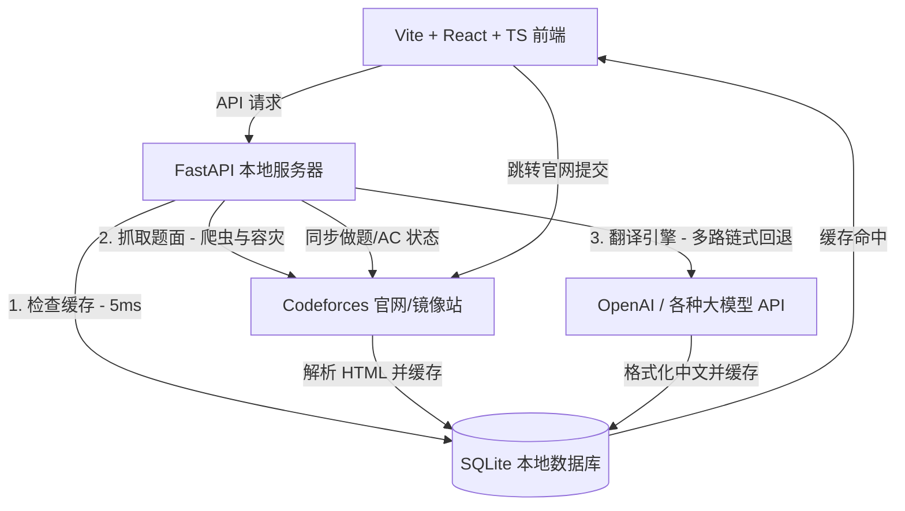

# Codeforces AI 智能双语翻译镜像站 (Premium Mirror)

> [!CAUTION]
> **🔒 本地自用安全警告与凭据保护提示 (Security & Credentials Warning)**
> 本系统为**本地自用设计**，您在“管理后台”录入的 Codeforces Handle、登录 Cookie 以及大模型 API Key 均以明文安全保存在本地 SQLite 数据库 `backend/cf_mirror.db` 中。
> - **切勿将包含您真实私密数据的 `backend/cf_mirror.db` 文件分享或提交至 GitHub 等任何公开仓库！**
> - **切勿与他人分享您的 `cf_mirror.db` 数据库文件！**
> - 本项目的 `.gitignore` 已预置安全防御规则自动拦截 `.db` 和 `.log` 文件，请务必保持防御配置开启，时刻保障个人账号资产安全。

---

这是一个为算法竞赛选手量身定制的 Codeforces 双语对照阅读与状态同步系统。通过结合轻量级网页爬虫、大模型多路容灾翻译引擎、React 协调隔离渲染技术以及本地缓存防抖机制，本系统能让您在本地电脑上享受极致流畅、小说般舒适的中文刷题体验。

---

## 🏗️ 核心系统架构 (System Architecture)

系统由以下五大核心模块协同运作，构建成工业级闭环：



1. **LaTeX 语法保护与爬虫模块 (`scraper.py`)**：
   - 抓取 Codeforces 原站 HTML。提取标题、限制、题面描述、输入/输出说明、评测样例以及提示（Notes）。
   - 内置 tokenizer 安全机制，对 Codeforces 原生 `$$$` 极其易碎的 LaTeX 标记进行捕获并清洗为标准 `$` delims，为 LLM 翻译做足语法保护。

2. **React Memo 隔离与 MathJax 3 渲染系统 (`ProblemViewer.tsx`)**：
   - **协调隔离（Memoization）**：为了彻底解决 React 虚拟 DOM 协调时将外部数学公式打回原形的问题，本系统将所有渲染的数学公式隔离在受 `React.memo` 保护的 `ProblemContent` 子组件中。即使您在主页面打字写代码、切换编译器或轮询评测，渲染后的公式也绝不会发生闪烁与退化。
   - **本地离线加载**：本地集成并版本控制了 MathJax 3 (包含 `color` 扩展)，无需外部互联网，完全本地离线加载并渲染 SVG 格式公式，保障极速、稳定的渲染体验。

3. **大模型多路容灾翻译链 (`translator.py`)**：
   - 允许用户在管理后台配置多组 LLM 模型节点（如 DeepSeek, GPT, Claude 等）。
   - **链式降级回退（Fallback Chain）**：如果优先级最高的 API 发生限流或欠费报错，系统会自动无缝切换至备用 API，若全部失败，平滑切换至系统自愈的“模拟翻译模式”，确保流程不发生阻断性 Crash。

4. **双向本地持久化缓存层 (`database.py` & `main.py`)**：
   - **题目缓存**：已翻译题目 100% 缓存入本地 SQLite，方便您在“本地已译题目”列表里进行零网络开销的历史查阅。
   - **大厅缓存（6h TTL）**：比赛大厅引入了 6 小时生命期缓存。第二次加载大厅实现 **5ms 瞬间秒开**，彻底告别原版 CF 接口的漫长转圈圈。
   - **离线安全高可用**：即使在断网状态，大厅依然允许加载过期缓存作为 Fallback，保障 100% 软件可用性。

5. **全链路高性能日志黑匣子 (`backend_app.log`)**：
   - 拦截所有前端发起的 HTTP 流量。
   - 自动在控制台与本地滚动日志中打印访问 IP、方法、路径、**毫秒级网络响应时长**以及 500 堆栈，方便硬核排错。

---

## 📁 规范项目工程目录 (Project Tree)

```text
CF/
├── backend/                  # 后端 FastAPI 翻译服务器
│   ├── __pycache__/
│   ├── cf_mirror.db          # SQLite 本地自愈式数据库 (自动生成并迁移)
│   ├── backend_app.log       # 本地 10MB 自动轮转性能日志 (自动生成)
│   ├── database.py           # SQLAlchemy 数据结构与索引自修复配置
│   ├── main.py               # FastAPI 服务主入口与日志/缓存中间件
│   ├── requirements.txt      # 后端依赖配置清单
│   ├── scraper.py            # Codeforces 题面抓取与 LaTeX 保护核心
│   └── translator.py         # LLM 链式智能翻译与 Fallback 降级引擎
│
├── frontend/                 # 前端 React + TypeScript 现代应用
│   ├── dist/                 # 静态打包资源目录
│   ├── node_modules/         # 前端依赖包
│   ├── public/               # 公共静态静态资源
│   ├── src/
│   │   ├── assets/
│   │   ├── AdminSettings.tsx # 大模型 Key 与 Cookie 配置后台
│   │   ├── App.css
│   │   ├── App.tsx           # 主程序控制中心与侧边栏路由
│   │   ├── CachedProblems.tsx# 本地已翻译历史题库视图
│   │   ├── Dashboard.tsx     # 极简官方比赛大厅与快速通道 (内置 Modal)
│   │   ├── index.css         # Harmonious Premium CSS 设计系统
│   │   ├── main.tsx
│   │   ├── ProblemsetLibrary.tsx # 官方 30000+ 题库快速检索面板
│   │   └── ProblemViewer.tsx # 双语对照阅读器与状态同步组件 (Memo)
│   ├── eslint.config.js
│   ├── index.html            # MathJax 3 配置与本地加载
│   ├── package.json          # 前端依赖与脚手架指令
│   ├── tsconfig.json         # TypeScript 编译配置
│   └── vite.config.ts        # Vite 打包配置
│
├── .gitignore                # 仓库级别防污染 Git 忽略清单
└── README.md                 # 软件工程系统架构与运维手册
```

---

## 🚀 部署与启动说明 (Deployment & Startup)

### 1. 后端 FastAPI 服务启动
请确保您的系统已安装 Python 3.8+。
1. 安装依赖包：
   ```bash
   pip install -r requirements.txt
   ```
   *(或者进入 `backend` 目录执行 `pip install -r requirements.txt`)*

2. 运行 FastAPI 服务（开发热重载模式）：
   ```bash
   cd backend
   uvicorn main:app --host 127.0.0.1 --port 8000 --reload
   ```
   *如果在服务器生产环境部署，建议将 `--host` 设置为 `0.0.0.0`，并移除 `--reload`，或使用 `gunicorn` / `pm2` 进行进程守护。*

---

### 2. 前端 Vite + React 启动
请确保您的系统已安装 Node.js (建议 v18+) 与 npm/yarn。
1. 进入前端目录并安装依赖包：
   ```bash
   cd frontend
   npm install --legacy-peer-deps
   ```
2. 启动开发服务器：
   ```bash
   npm run dev
   ```
3. 生产环境打包部署（推荐）：
   ```bash
   npm run build
   ```
   打包完成后，将 `dist` 目录配置至 Nginx / Apache 或使用静态文件托管服务即可。

---

## 🔒 Codeforces 做题状态同步与高级设置

为了在本地镜像站自动同步并显示您在 Codeforces 的做题记录 (AC/FAILED 状态标记)：
1. 您只需要前往镜像站的 **「管理后台 (设置)」** 中录入您的 **Codeforces 用户名 (Handle)**，即可立刻开启极速异步状态同步。AC 状态同步完全由公共接口拉取，**不需要提供任何密码或 Cookie 凭据**，保障您的账号资产安全！
2. 浏览器登录 Cookies 仅作为高级/保留功能折叠在后台设置中（用于未来代理提交等用途，目前代理提交功能默认在后端关闭，即 `ENABLE_CF_PROXY_SUBMIT` 默认为空）。如无特殊需要，建议保持留空即可。

---

## 🛡️ 软件维护与排错
- **公式加载？**：MathJax 静态资源已完全保存在本地 `frontend/public/` 目录下，100% 本地极速加载，不依赖 any 外部 CDN，且内置白名单 HTML 清洗过滤以确保公式安全渲染。
- **系统报错？**：可直接打开 `backend/backend_app.log` 文本文件。全链路中间件已将所有的 API 延迟毫秒数与 500 Stacktrace 记录其中，像飞机黑匣子一样清晰好找！
