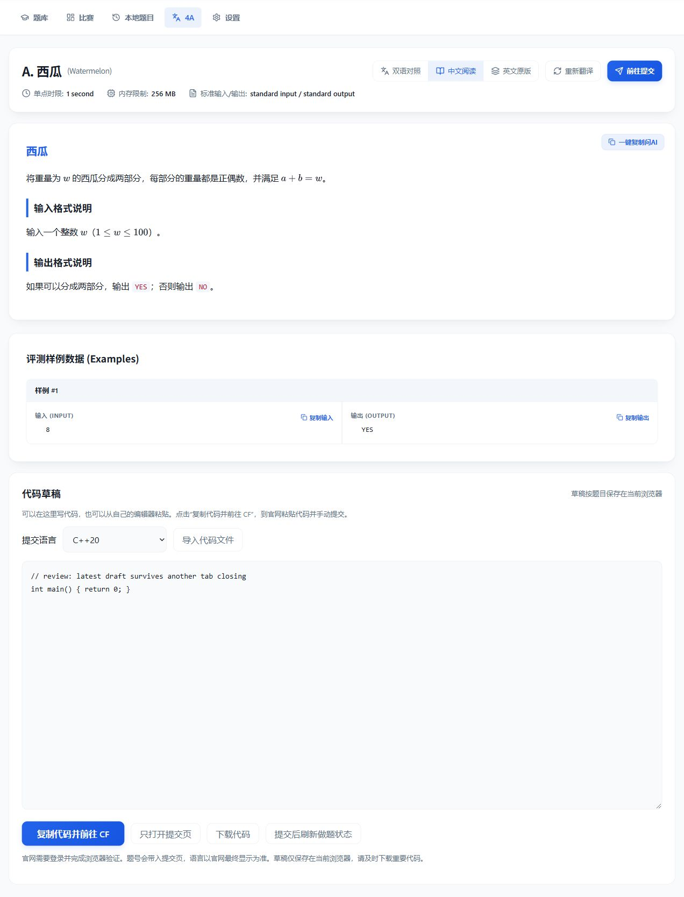

# 2026-10-27 项目复审

这次基于当前工作区重新审查，覆盖 Flask 接口、抓题与解析、翻译校验与缓存、并发与批量任务、SQLite、前端状态、草稿、提交跳转、Windows 启停和依赖。保留原有未提交修改，没有创建提交或改动 Git 历史。

## 已确认并修复的问题

| 优先级 | 触发与影响 | 处理与位置 |
| --- | --- | --- |
| P1 | 同一题开两页，在新页修改代码后，旧页关闭或隐藏时无条件保存自己的旧内容，覆盖新草稿。翻译完成后自动刷新也可能丢弃保存失败的代码。 | 草稿记录本页基线；未改动的旧页不回写；未编辑页面接收其他页的新草稿；同时编辑时检测冲突、保留当前编辑器内容并提示下载；保存失败阻止自动刷新及静默离开。见 `static/js/problem.js`。 |
| P1 | 修改一个已经禁用的模型节点时，前端固定提交 `is_active: true`，导致它被意外启用并参与后续付费翻译。优先级 0 也会被改成 1。 | 编辑保存保留原启用状态和优先级 0；输入范围与服务端一致。见 `static/js/settings.js`、`templates/settings.html`。 |
| P2 | 普通比赛 `contest.standings` 的旧分页请求返回 HTTP 400。题目不在本地题库时，比赛弹窗因此无法列题。 | 本地查询失败后读取公开比赛页的题目列表，复用已验证的请求头及页面限速，缓存 5 分钟、最多 64 场；不为题目名称下载全榜。见 `core/scraper.py`、`core/api/problems.py`。 |
| P2 | 批量翻译绕开前台任务状态，题目页会显示“仅原文”，无法追踪实际正在运行的翻译；前台与批量的错误也不统一。 | 批量加入同一个逐题后台任务并等待结果；状态接口、单题页面和批量记录共享阶段及错误；原文页通过全局队列检查发现后台生成的译文。见 `core/problem_service.py`、`core/cf_sync.py`、`static/js/problem.js`。 |
| P2 | 旧队列检查到空后、执行清理前，新请求仍可能被当作“追加成功”，随后被旧任务清空。线程启动很快时，启动提示还会把 1 题误报成 0 题。 | 判空和结束标记在同一锁内完成；每个工作线程只清理自己那份队列；启动题数在线程运行前固定。见 `core/cf_sync.py`。 |
| P2 | 翻译中删除缓存时接口先返回成功，后台稍后又写入该缓存。 | 删除与任务注册、正在写入的逐题锁协调；忙碌时返回 409 和可操作提示；批量未结束时拒绝清理缓存。见 `core/problem_service.py`、`core/api/problems.py`。 |
| P2 | 比赛弹窗先打开 A 再快速打开 B，A 的慢响应可能覆盖 B 的内容。题库的过时错误响应也可能覆盖新列表。 | 取消过时请求，并在成功、错误和关闭弹窗时核对请求身份。见 `templates/dashboard.html`、`static/js/problemset.js`。 |
| P2 | 抓题解析用全文替换移除 `input`/`output` 标签，把 `input.txt`、`output.txt` 文件名截成 `.txt`，`standard input` 也会变成 `standard`。 | 只移除 `.property-title` 标签，保留其余实际内容。见 `core/scraper.py`。历史缓存不自动重抓，本次修正作用于新抓取。 |
| P2 | 题面正文包含“Just a moment”等普通句子时，会被误判为验证页，即使状态码 200 且有完整题面。 | 优先检查目标内容节点；验证词只在缺少实际内容时用于判断，仍识别显式验证响应头。见 `core/scraper.py`。 |
| P2 | 超长数字搜索、过大页码或比赛 ID 会使 SQLite 参数溢出；删除后末页可能显示空列表。 | 限制 ID、页码，超长数字按文本搜索；本地分页及题库页面回落到有效页。见 `core/content.py`、`core/pages.py`、`core/api/problems.py`、`static/js/problemset.js`。 |
| P2 | 不规范的模型响应可能抛出 `AttributeError`，中断节点回退；配置测试的错误 ID 类型会进入数据库查询，测试期间也占用数据库连接。超大请求还返回前端难以解析的 HTML。 | 模型响应统一转换为安全错误；验证测试节点 ID，调用网络前释放读事务；API 的 HTTP 错误以 JSON 返回。见 `core/translator.py`、`core/api/config.py`、`main.py`。 |
| P2 | 仅原文题目仍可切换到空白中文栏；顶部同步按钮点击后会同时执行同步与链接跳转。 | 未译题禁用中文和双语切换，并在函数内兜底为英文；同步点击阻止默认跳转。见 `templates/problem.html`、`static/js/problem.js`、`static/js/app.js`。 |

此外补入与现有 MathJax 3.2.2 对应的本地 `ui/safe` 组件及许可证，过滤渲染阶段生成的危险 URL 和属性，明确禁用 `file:`、`javascript:`、`data:`。这是渲染层的补强，本轮没有声称已经复现可执行的攻击。机制依据见 [MathJax 官方说明](https://docs.mathjax.org/en/v3.2/options/safe.html)。

比赛接口规则变化已通过实际 HTTP 400 响应和 [CF 官方方法文档](https://codeforces.com/apiHelp/methods#contest.standings) 双重核实。普通公开比赛的榜单请求现在只能带 `contestId`，并返回完整官方榜单，所以这里改读比赛页。

## 验证

- 41 项 Python 回归、17 个前端回归场景通过。单元测试使用独立临时数据库，模型调用替换为固定响应。
- 覆盖正在翻译时删除、前台与批量加入同一任务、任务失败传播、队列清理边界的新任务、快速启动导致的计数变化、草稿多页同步与冲突、禁用节点编辑、弹窗旧请求、超长数字及异常接口响应。
- 实际抓取 2232A、2232B、4A 成功，均能解析标题、样例和正确的输入输出元数据。
- 独立空数据库下，`/api/contest/2232/problems` 通过真实官网页面返回 200 和全部 7 道题，包括 C1/C2，验证了本地未收录比赛的整条后备路径。
- 浏览器在独立离线预览服务中检查数学公式正常显示、无控制台错误；两页同题自动同步草稿，关闭旧页并刷新后，新代码仍保留。测试完成后恢复原有预览草稿。
- 浏览器验证批量启动准确显示 1 题；另一已打开且保持可见的仅原文页面在批量完成后自动显示中文。周期检查补足多窗口可见、没有触发切换标签页事件的情况。
- 使用真实数据库副本验证全部 126 道缓存页面、11,223 条题库的列表与搜索、设置页和极大页码；页面检查全部通过。
- 未调用实际付费翻译模型，未在 CF 提交代码，也没有清空实际缓存或改动用户配置。

## 后续优先事项与限制

1. 任务队列仍在内存中，重启会丢失尚未完成的任务。需要断点续跑时应增加任务持久化，而非仅持久化结果。
2. 草稿仍由当前浏览器保存；两个标签页同时编辑冲突时需要下载各自代码并自行合并。本轮提供冲突检测，没有把本地存储改造成协同编辑器。
3. 自动结构校验无法证明译文语义完全正确；真实供应商的付费端到端测试及关键边界条件的人工对照仍未执行。
4. 官网图片尚未本地缓存；“离线阅读”目前不能保证所有插图可用。
5. 比赛题目列表的新后备路径依赖公开页面结构；主站或镜像仍可能出现验证、登录要求或网络故障。已保留原有手动导入题面流程。

## 浏览器验证截图

离线预览中的固定译文，仅用于验证页面和草稿行为，不代表付费模型的翻译质量。

