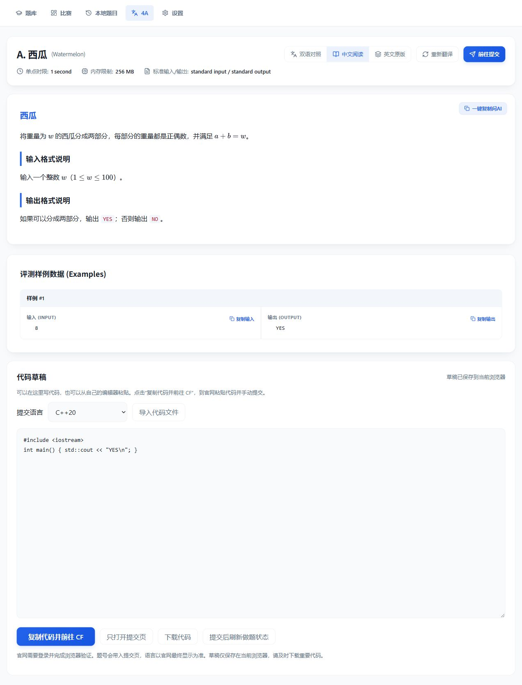

# 项目审查与改进记录

审查日期：2026-10-26。基线是本次开始时的工作区，包含已有的未提交修改。既有 Flask 架构、API 分包和官网提交跳转继续沿用，没有重置工作区或创建提交。

目标是帮助中文用户完成“找到题目、可靠地读中文、练习代码、到 CF 手动提交”。现有技术栈适合本地个人使用，无需引入新的前端框架或独立任务服务。

## 主要发现与处理

| 优先级 | 发现与影响 | 本轮处理 |
| --- | --- | --- |
| P1 | 模型失败会生成虚构的中文输入、输出及提示；首访 `cache_mock=true` 会永久保存它。用户可能按不存在的条件解题。 | 删除模拟翻译；模型失败保留原题并明确报错。旧模拟缓存迁移为“仅原文”，升级前备份数据库。当前实际数据库有 126 道缓存，未发现旧模拟缓存标记。 |
| P1 | 公式保护依赖提示词和事后猜测修复，缺少遗漏、重复和跨字段校验。 | 公式和代码常量用唯一占位符保护，校验字段、出现次数、所在字段、公式集合、图片、链接和 HTML 结构后再保存。 |
| P1 | CF 抓取和模型 HTML 直接 `safe` 渲染；模型连接结果通过 `innerHTML` 输出。恶意内容可能访问本地配置接口。 | 使用 HTML 白名单清洗，移除脚本、事件属性和危险 URL；连接结果转义；本地接口校验 Host、Origin 与跨站请求。 |
| P1 | 页面翻译锁会在仍有等待者时被移除；批量翻译完全绕开这把锁。相同题目可能重复扣费和写入冲突。 | 前台、后台共用带引用计数的逐题锁，重新检查缓存；模型并发数限制为 2。 |
| P1 | 更新缓存先删除并提交，再插入。后续失败时会丢掉旧译文。 | 更新在一个事务中完成；重译失败保留上一份成功译文。 |
| P1 | 页面首次读取持续等待抓取与模型响应，默认 SDK 重试会进一步延长等待。 | POST 创建后台任务，GET 轮询阶段；原题先持久化，模型调用设连接与读取超时，取消隐藏重试。 |
| P1 | 各功能独立调用 CF API，评测队列每 2.5 秒逐题请求，容易违反全局限速。 | 统一 CF API 请求门控，间隔至少 2.1 秒；删除无入口的代理提交评测队列与对应轮询接口。 |
| P1 | 原停止脚本按端口匹配并强杀所有连接相关 PID，可能误杀浏览器或其他程序。 | 启动后记录 PID、可执行文件和 Windows 进程创建时间；停止前校验精确身份，拒绝复用的 PID，并兼容 uv 虚拟环境的启动转发。 |
| P2 | 题库和标签一次构造大量 SQL 参数，部分 SQLite 环境会超过绑定变量上限；标签只追加、不清除旧标签。 | 使用分批 executemany，全量题库、标签与 FTS 原子替换；失败回滚，拒绝用空响应覆盖题库。 |
| P2 | 重启丢失做题状态；切换账号时旧请求可能覆盖新账号缓存；评测中会被当成失败。 | 保存做题状态，后续增量同步；使用请求代际检查，忽略旧账号结果，评测中不标为失败。 |
| P2 | 首次抓取遍历六个路由，风控时耗时很长，错误没有可操作的出口。 | 保留原站和官方镜像的 contest、problemset 合法路径；Gym 只走 gym 路径；429 立即停止；提供官网入口和粘贴原题翻译。 |
| P2 | 字体和图标依赖国外 CDN；窄屏缺少布局处理。 | 图标本地化、系统中文字体、窄屏阅读和代码区布局；保留图标许可。 |
| P2 | 无代码草稿，跳转提交前仍需另外整理代码；语言版本文案陈旧。 | 按题保存草稿、导入及下载代码、复制后跳转提交；默认沿用官网语言选择，移除容易过期的版本号描述。 |
| P2 | README 保留了已删除的代理提交、模拟翻译和多进程部署说明；依赖与 uv 锁文件不一致。 | 重写使用说明，更新依赖和完整锁文件；改用 Waitress 单进程运行，兼容 API 请求不再依赖旧 SDK/httpx 组合。 |
| P2 | 列表失败时骨架屏不消失，快速筛选可能被旧请求覆盖；本地列表一次渲染所有缓存。 | 错误状态带重试按钮；中止过时列表请求；本地缓存每页 50 题。 |

P1 表示可能直接损害解题正确性、数据、费用或本机安全；P2 表示会影响稳定性、性能或使用体验。

## 验证

- Python 回归：27 项通过，使用临时数据库并禁止真实网络和付费模型请求。
- JavaScript 回归：8 个场景通过，包括样例中的字面反斜杠、语言与 Gym URL、剪贴板拒绝、弹窗拦截、空草稿和存储空间不足。
- 后端覆盖旧库备份与重复迁移、字段和公式损坏、节点回退、失败后的缓存恢复、6 路并发只翻译一次、SQLite 999 绑定变量限制、同步失败的整体回滚、账号切换和 PID 误杀保护。
- 浏览器使用独立的离线预览数据库检查数学排版、样例复制、草稿刷新保存与按题隔离、重译后刷新。并检查 390px 窄屏布局、CF 抓取失败后粘贴 HTML 题面恢复翻译。窄屏下页面内容没有水平溢出。
- 首轮实际原站请求遇到浏览器验证，官方镜像超时。用户反馈旧版可用后，同机对比确认是本轮简化请求头导致的回退：2232A 使用简化请求头返回 HTTP 403 和验证页，使用旧版完整请求头返回 HTTP 200 和完整题面，contest 与 problemset 路径均成功。已恢复旧版请求头及 problemset 后备路径，并将普通 HTTP 403 与确实返回验证页的情况区分记录。修复后的真实抓取函数对 2232A（Convergence）和 2232B（Cake Leveling）均返回 HTTP 200，成功解析标题、正文、输入输出说明和样例；未调用付费翻译模型。
- 在真实数据库的副本上完成升级，并渲染全部 126 道缓存题目；11,223 条题库的默认列表、名称搜索和难度筛选均返回成功。
- 独立临时数据库下实际启动 Waitress、验证健康接口，再通过新停止脚本终止对应服务，成功。
- Python 语法检查、基础静态检查、uv 锁文件一致性和 Git 补丁空白检查通过。
- 没有调用实际配置的付费大模型，也没有在 CF 实际提交代码。

## 仍需知道的限制

1. 结构和公式校验无法证明翻译语义完全正确。对关键限定词、量词和边界条件，应保留英文对照。历史成功缓存不会自动重新调用模型，怀疑旧译文有误时请重新翻译。
2. CF 风控仍可能阻止自动抓取。工具不保存或使用 CF 登录 Cookie，也不自动操作浏览器验证或官网提交表单。
3. 翻译队列是进程内任务。关闭进程会丢失尚未完成的队列；结果逐题保存，可以重新选题继续。必须保持单进程，不能照旧 README 启动多个 Gunicorn worker。
4. 浏览器草稿依赖当前设备、浏览器和访问地址。`localhost` 与 `127.0.0.1` 的存储互不相通，重要代码建议下载备份。
5. 纯文本粘贴不能恢复复制时已经丢失的公式，也不猜测样例分区；使用包含原始公式的 HTML 效果更完整。
6. 图片地址已解析为绝对地址，但图片文件尚未本地持久化；离线时部分插图无法显示。后续若需要练习图论、几何题的完整离线能力，应优先补上受限来源的图片缓存。

CF 请求规则参考 [官方 API 文档](https://codeforces.com/apiHelp)。日常本地服务使用 WSGI 容器的依据见 [Flask 部署说明](https://flask.palletsprojects.com/en/stable/deploying/)。

## 练习页预览

以下是独立离线预览数据，不是实际模型翻译的质量评测。

